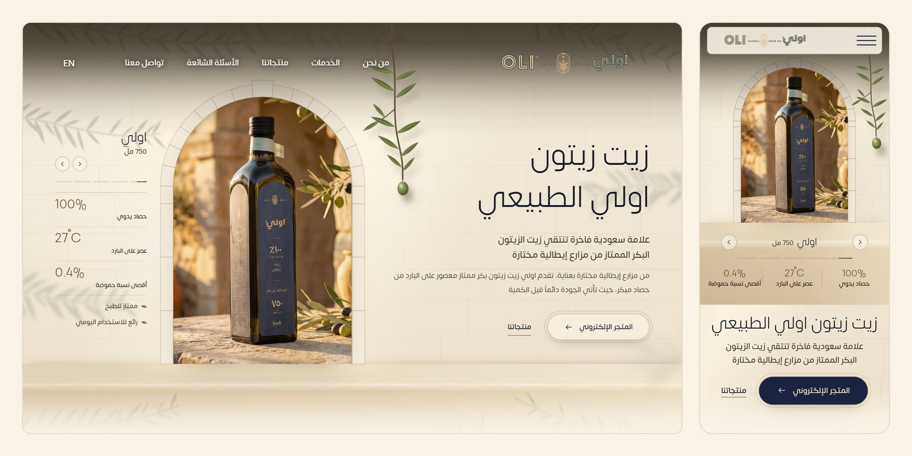
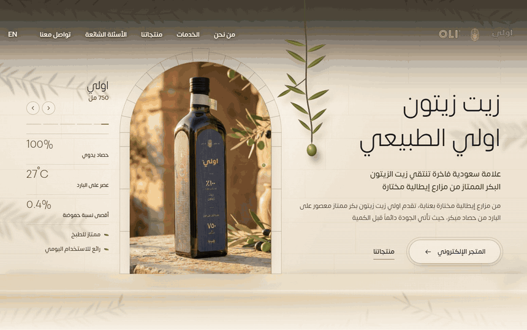
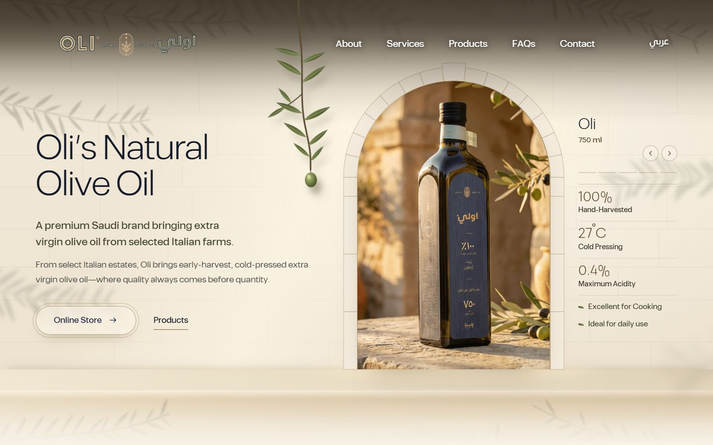
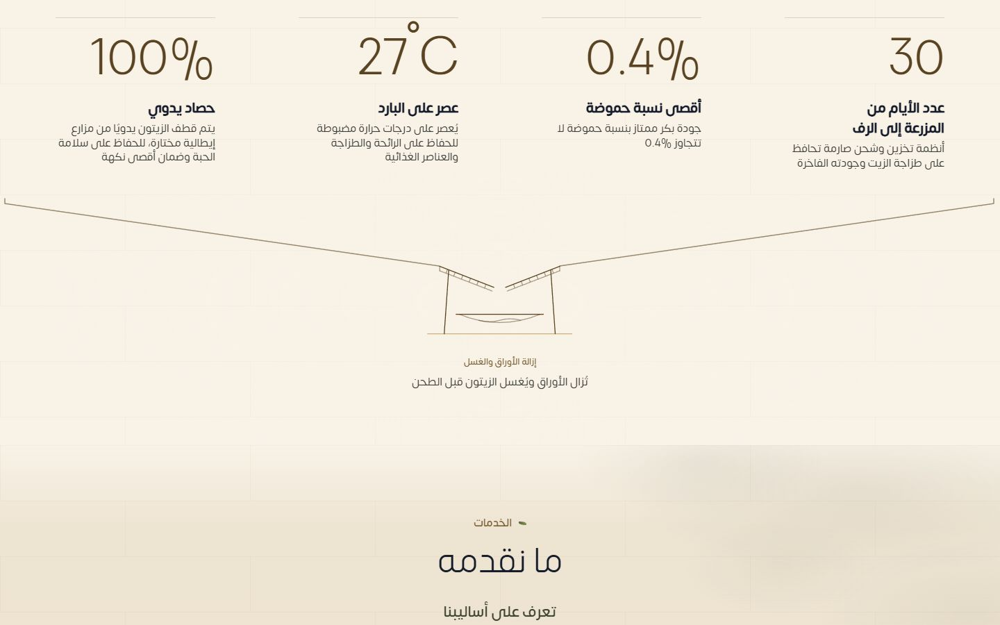
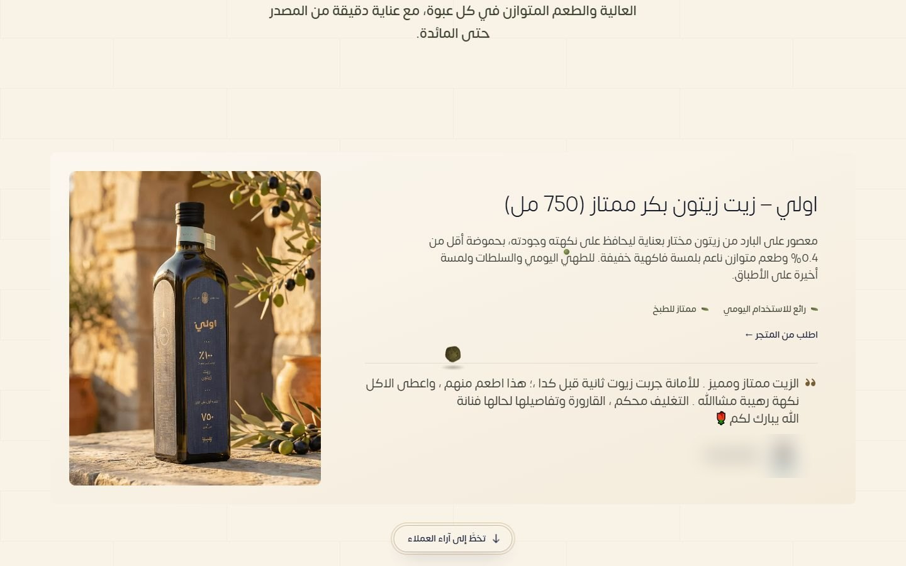

[English](README.md) · **العربية**

هذا الموقع الجديد لعلامة اولي (OLI)، وهي علامة سعودية تبيع زيت زيتون إيطاليًا بكرًا ممتازًا. الصفحة الرئيسية بالعربية، وللموقع نسخة إنجليزية كاملة على `/en`. الموقع موجّه للمتسوّقين في السعودية، وكل بطاقة منتج فيه تفتح صفحة المنتج نفسه في المتجر الإلكتروني.

تصميم وتطوير: **محمد التونسي** · [لينكدإن](https://www.linkedin.com/in/mohammed-altounsi/)

النسخة التجريبية مستضافة على خطة Render المجانية، لذلك قد يستغرق فتحها دقيقة تقريبًا إذا لم يزرها أحد منذ فترة.

## جولة في الصفحة

## محتوى الموقع

من الأعلى إلى الأسفل، في الصفحتين العربية والإنجليزية:

- **الواجهة الرئيسية:** صورة المنتج داخل قوس حجري، وأسهم للتنقل بين المنتجات (ويمكن السحب بالإصبع أيضًا)، وزر يفتح المتجر. غصن الزيتون يتمايل ويتحرك مع المؤشر.
- **من نحن:** تعريف بالعلامة وسبب اختيارها زيت إيطاليا، مع صور للعبوات.
- **الخدمات:** صفوف تُفتح بالضغط، ولكل صف صورته. على الجوال تظهر الصورة تحت عنوان الصف المفتوح.
- **المنتجات:** بطاقة لكل منتج، وتتراكب البطاقات مع التمرير. في البطاقة وصف المنتج ووسومه ورابط لطلبه من المتجر.
- **آراء العملاء والأسئلة الشائعة وتواصل معنا:** نموذج التواصل يوصل الرسالة إلى بريد العلامة.

بين الأقسام رسومات خطية لمراحل صناعة الزيت: القطف، ثم إزالة الأوراق والغسل، ثم الطحن والعجن والفصل والترسيب، وأخيرًا التعبئة. يظهر كل رسم حين يصل إليه الزائر. وتسقط حبة زيتون من الواجهة وتنزل مع الصفحة، فتقع على حواف الصور والبطاقات وتتدحرج عنها، وتدخل كل آلة في طريقها. في الطاحونة تصير عجينة، وفي جهاز الفصل تصير قطرة زيت.

## طريقة البناء

- ملفات HTML وCSS وJavaScript ثابتة، بلا خطوة بناء.
- بدأ تخطيط الصفحات من تصدير Framer. محرّك Framer وملفاته محفوظة مع الموقع، فلا يطلب الموقع أي شيء من خوادم Framer.
- كتبتُ الواجهة الرئيسية ورحلة حبة الزيتون وبطاقات المنتجات المتراكبة ونسخة الجوال من قسم الخدمات بـJavaScript وCSS عادية، ويحمّلها الموقع فوق الصفحات المصدّرة. وملف تحميل صغير يضع الواجهة الجديدة مكان بانر Framer الأصلي.
- ملف تنسيق واحد يعيد تلوين أقسام Framer بألوان الواجهة: لون الحجر الجيري والذهبي والكحلي.
- الواجهة الرئيسية ورحلة الزيتونة تراعيان إعداد تقليل الحركة في جهاز الزائر.
- نموذج التواصل يرسل إلى ملف PHP صغير يحدّ عدد الرسائل من كل عنوان IP، ولا يقبل إلا ما يأتي من نطاق العلامة.

## لقطات من الموقع

<table>
  <tr>
    <td width="50%"></td>
    <td width="50%"></td>
  </tr>
  <tr>
    <td colspan="2"></td>
  </tr>
</table>

---

> يعرض هذا المستودع تصميم الموقع وواجهته الأمامية، أما الكود المصدري فخاص. لطلب موقع مشابه، راسلني على [لينكدإن](https://www.linkedin.com/in/mohammed-altounsi/).

